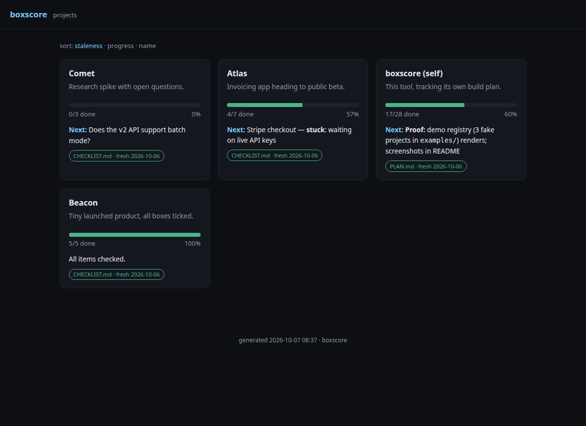

# boxscore

> Your repos already keep score. boxscore shows you the game.

Turns the markdown checklists you already maintain (`- [ ]` / `- [x]`) across your repos into a
static status dashboard: a hub page with a card per project — true-fraction progress bar, the
next open item, and a freshness badge per source file — linking to a rendered page per project.

No database. No LLM. No tokens. Status is **derived from checkbox state in version-controlled
markdown**, never summarized by anything that can hallucinate. Stale sources are badged, because
a dashboard that looks current and isn't is worse than none.



## Quickstart (demo)

```bash
git clone https://github.com/tgalt/boxscore && cd boxscore
python3 -m boxscore build -c examples/demo.toml -o site/
python3 -m http.server -d site 8000   # open http://localhost:8000
```

Requires Python 3.11+ — standard library only, nothing to `pip install`. Then copy
`projects.toml.example` to `projects.toml`
(gitignored) and point it at your own checkouts. Full design + roadmap: [PLAN.md](PLAN.md).

Private hosting tip: serve `site/` over your tailnet with `tailscale serve`.

## Operate (private dashboard pattern)

Rebuild on a schedule (crontab, from the boxscore checkout):

```cron
*/30 * * * * cd /path/to/boxscore && python3 -m boxscore build -c projects.toml -o /srv/boxscore-site
```

Serve tailnet-only, either way:

```bash
# recommended: static server on localhost + tailscale serve proxy
# (directory-serving via tailscale needs root; proxying only needs operator:
#  one-time `sudo tailscale set --operator=$USER`)
python3 -m http.server 8311 --bind 127.0.0.1 --directory /srv/boxscore-site &
tailscale serve --bg --set-path=/ http://127.0.0.1:8311
# alternative, zero tailscale config: bind the static server to your Tailscale IP
python3 -m http.server 8311 --bind <your-tailscale-ip> --directory /srv/boxscore-site
```

Both are reachable only from your tailnet; transport is WireGuard-encrypted either way.
